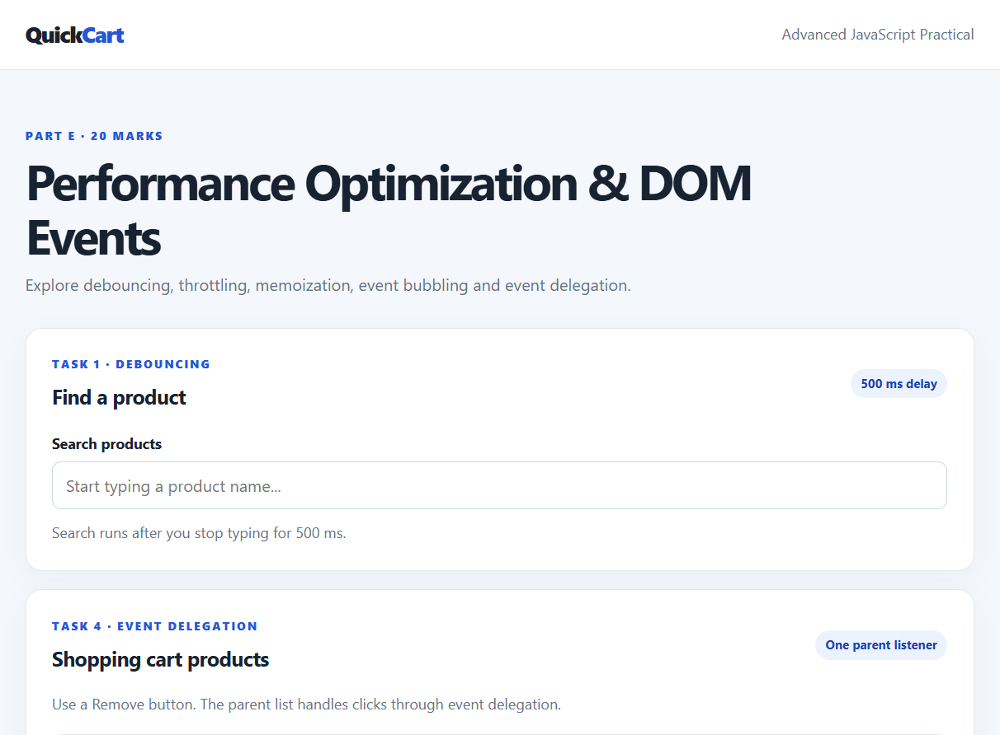
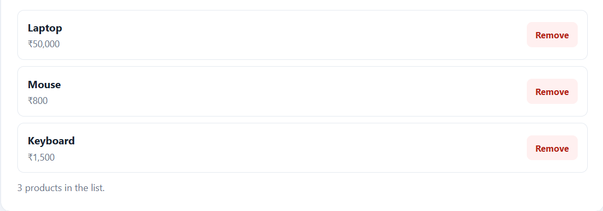

# QuickCart – Advanced JavaScript Practical Assignment

A six-part implementation of the **Advanced JavaScript Practical Assignment** (November 2026). The project demonstrates modern JavaScript (ES6+) through product objects and classes, shopping-cart calculations, JSON handling, asynchronous order processing, browser performance patterns and DOM events, and a final integrated order summary.

## Technologies

- Modern JavaScript (ES6+)
- Node.js (CommonJS modules for the standalone exercises)
- HTML5 and CSS3
- Native browser DOM APIs
- Native Node.js test runner (`node:test`)
- No frameworks, third-party libraries or external runtime dependencies

## Project structure

```text
quickcart-advanced-javascript/
├── part-a-objects-classes/
│   └── products.js
├── part-b-array-methods/
│   └── shopping-cart.js
├── part-c-json-debugging/
│   └── json-handling.js
├── part-d-asynchronous/
│   └── order-processing.js
├── part-e-optimization-events/
│   ├── index.html
│   ├── script.js
│   └── style.css
├── part-f-integration/
│   └── quickcart.js
├── tests/
│   └── quickcart.test.js
└── README.md
```

## Requirements

- Node.js 18 or later (the project was verified with Node.js 22).
- A modern browser for Part E.
- No `npm install` step is needed because the project uses only built-in JavaScript and Node.js functionality.

## Run each part

Run these commands from the project root:

```bash
node part-a-objects-classes/products.js
node part-b-array-methods/shopping-cart.js
node part-c-json-debugging/json-handling.js
node part-d-asynchronous/order-processing.js
node part-f-integration/quickcart.js
```

Part D intentionally waits for the specified asynchronous delays. It demonstrates the event loop, three sequential callback steps, three sequential Promise steps, async/await, and all four Promise combinators.

### Run Part E in a browser

1. Open `part-e-optimization-events/index.html` directly in a modern browser, or serve the project root with a local static server.
2. Type into the search field and pause for 500 ms to observe debouncing.
3. Scroll the page to observe the throttled scroll handler (1000 ms interval).
4. Press the discount buttons twice and inspect the browser console for fresh-calculation and cache-hit messages.
5. Use the two bubbling buttons to compare normal propagation with `event.stopPropagation()`.
6. Remove products. The single click listener on the list parent identifies the clicked Remove button and removes its product row.

Example static-server command (optional):

```bash
python -m http.server 8000
```

Then visit `http://localhost:8000/part-e-optimization-events/`. This uses Python’s built-in static server and adds no project dependency.

## Run tests

From the project root:

```bash
node --test
```

The native test suite checks prototype sharing, class inheritance, calculations, Map and Set operations, freeze/seal behavior, JSON serialization, the specified mock API outcomes, debounce, throttle, memoization, and the Part F integration total.

## Part-by-part overview

### Part A – Objects, Prototypes & ES6 Classes

`products.js` demonstrates a constructor function with `Product.prototype.displayProduct()`, three constructor-created products, an ES6 `Product` class, `ElectronicProduct` and `ClothingProduct` subclasses, and arrow functions, template literals, destructuring, rest and spread syntax. The constructor and class demonstrations are scoped separately because the assignment uses the same identifier (`Product`) for both forms.

### Part B – Higher-Order Functions, Map, Set & Object Methods

`shopping-cart.js` contains the five products and calculates per-item totals, products above ₹2,000, the cart total, and the Electronics total. It also demonstrates inventory operations with `Map`, duplicate removal with `Set`, and mutation attempts against frozen and sealed copies of the product configuration.

### Part C – JSON Handling & Output-Based Debugging

`json-handling.js` serializes and parses the specified order and reports the six requested output/error cases. Error-producing examples are caught and displayed so the remaining demonstrations can continue.

### Part D – Asynchronous JavaScript

`order-processing.js` demonstrates event-loop ordering, callback sequencing, Promise chaining, async/await with try/catch, and the four Promise combinators. The mock APIs use the assignment's exact outcomes and delays: products resolves after 1,000 ms, payment rejects after 1,500 ms, and delivery resolves after 2,000 ms.

### Part E – Performance Optimization & DOM Events

`index.html`, `script.js` and `style.css` provide a responsive browser page with a 500 ms debounced product search, a 1,000 ms throttled scroll handler, closure-based memoization, a three-product Remove list using event delegation, and separate bubbling/stop-propagation demonstrations.

### Part F – Final Integration Challenge

`quickcart.js` builds the Rahul order using a `Product` class and the required array methods, `Set`, `Map`, `Object.freeze()`, JSON serialization and async/await confirmation. The ₹69,000 total is calculated from the four product records rather than hardcoded.

## Conceptual question answers

### Part A – Objects, prototypes and ES6 classes

1. **Why put `displayProduct()` on the prototype?** Every instance can share the same function instead of creating a separate function property on each product, reducing duplication.
2. **`__proto__` vs `prototype`:** `__proto__` is an object's accessor to its prototype (the object from which it inherits). A constructor function's `prototype` is the object assigned as the prototype of instances created with `new`.
3. **What if a property is not found on an object?** JavaScript checks the object's prototype, then continues up the prototype chain. If it reaches `null` without finding the property, the result is `undefined`.
4. **Purpose of `extends`:** It establishes class inheritance so a child class can inherit methods from a parent class.
5. **Why call `super()` before `this`?** In a derived class constructor, `super()` initializes the parent part of the instance and must run before the child constructor can access `this`.
6. **Are ES6 classes completely different from prototype inheritance?** No. Classes provide cleaner syntax over JavaScript's prototype-based inheritance model.

### Part B – Array methods, Map, Set, freeze and seal

1. **`map()` vs `forEach()`:** `map()` returns a new array containing each callback result; `forEach()` runs a callback for each element and returns `undefined`.
2. **Does `filter()` change the original array?** No. It creates a new array containing elements that pass the test.
3. **Why use `reduce()` for totals?** It accumulates array values into one result, such as a numeric sum.
4. **Which method returns a new transformed array?** `map()`.
5. **Map vs plain object:** A `Map` accepts keys of any value type, preserves insertion order, exposes `size`, and provides direct methods such as `get`, `set` and `delete`. Plain object keys are strings or symbols (with property-key coercion for other values).
6. **Why is Set useful for duplicates?** A Set stores each value only once.
7. **Can a Map use an object as a key?** Yes. Object keys are compared by identity.
8. **Does Set preserve insertion order?** Yes; iteration follows insertion order.
9. **`Object.freeze()` vs `Object.seal()`:** A frozen object cannot have properties added, removed or reassigned. A sealed object cannot have properties added or removed, but existing writable properties can still be changed.
10. **Can a property change after `seal()`?** Yes, if that property's writable attribute is true.
11. **Are nested objects frozen automatically?** No. `Object.freeze()` is shallow.
12. **What is shallow freezing?** Only the top-level object's own properties are frozen; referenced nested objects can still be changed unless frozen separately.

### Part C – JSON handling

- `JSON.stringify()` omits object properties whose values are `undefined` or functions. In arrays, those values are serialized as `null` to preserve array positions.
- Functions are not JSON data values, so function-valued object properties are omitted. `undefined` is also not representable in JSON; its serialization behavior depends on whether it occurs in an object or array.
- `NaN` and positive/negative `Infinity` serialize as `null`. Invalid JSON throws a `SyntaxError`. A circular reference causes `JSON.stringify()` to throw a `TypeError`. A valid `Date` is converted to its ISO date-time string through `toJSON()`.

### Part D – Asynchronous JavaScript

1. **Why does a Promise callback run before `setTimeout(..., 0)`?** Promise reactions are microtasks, which are processed after the current synchronous stack empties and before the event loop proceeds to timer tasks.
2. **Microtask vs macrotask queues:** Promise reactions and other microtasks run in the microtask queue. Timer callbacks and many event callbacks are scheduled as tasks (often informally called macrotasks).
3. **Role of the call stack:** It tracks the currently executing functions; queued callbacks cannot run until the stack is clear.
4. **What does the event loop do?** It coordinates execution by checking when the call stack is clear and scheduling queued work.
5. **`Promise.all()` vs `Promise.allSettled()`:** `all()` fulfills when all inputs fulfill and rejects as soon as an input rejects. `allSettled()` waits for every input and returns each outcome's status and value/reason.
6. **Does `Promise.race()` wait for success?** No. It settles with the first input Promise to settle, whether fulfilled or rejected.
7. **`Promise.any()` vs `Promise.race()`:** `any()` fulfills with the first fulfilled input and ignores earlier rejections while waiting; `race()` adopts the first settlement of either kind.
8. **What if every Promise passed to `any()` rejects?** The returned Promise rejects with an `AggregateError` containing the rejection reasons.
9. **Why is callback hell difficult to maintain?** Deeply nested callbacks make control flow harder to read, reason about, reuse and handle errors in consistently.

### Part E – Performance optimization and DOM events

1. **Debouncing vs throttling:** Debouncing runs after calls have stopped for the configured delay. Throttling limits execution to at most once per configured interval.
2. **Which suits search suggestions?** Debouncing, because it waits until the user pauses typing.
3. **Which suits scroll and resize?** Throttling, because it limits how often handlers run during frequent events.
4. **What is memoization?** Caching a function's result for given arguments and reusing it for later calls with the same arguments.
5. **How does memoization improve performance?** It avoids repeating a calculation when the same inputs occur again, trading memory for reduced computation.
6. **What role do closures play?** A closure lets the returned wrapper retain access to the cache between calls.
7. **What is event bubbling?** An event handled on a nested element can propagate from that target through its ancestors.
8. **What is event delegation?** A parent handles events from its descendants using one listener and identifies the originating child.
9. **Why is delegation useful for dynamic elements?** Newly added descendants can be handled by the existing parent listener without attaching a separate listener to each new element.
10. **What does `event.stopPropagation()` do?** It stops the event from continuing through the propagation path.
11. **`event.target` vs `event.currentTarget`:** `target` is the element where the event originated; `currentTarget` is the element whose listener is currently executing.

## Requirement traceability and verification

| Assignment section                                               | Implementation                            | Verification                                                                                                |
| ---------------------------------------------------------------- | ----------------------------------------- | ----------------------------------------------------------------------------------------------------------- |
| A – Objects, prototypes, classes and ES6 syntax                  | `part-a-objects-classes/products.js`      | `tests/quickcart.test.js` – Part A tests                                                                    |
| B – Array methods, Map, Set, freeze and seal                     | `part-b-array-methods/shopping-cart.js`   | `tests/quickcart.test.js` – Part B tests                                                                    |
| C – JSON handling and six output predictions                     | `part-c-json-debugging/json-handling.js`  | `tests/quickcart.test.js` – Part C tests                                                                    |
| D – Event loop, callbacks, Promises, async/await and combinators | `part-d-asynchronous/order-processing.js` | `tests/quickcart.test.js` – mock API test; run Part D for full sequence                                     |
| E – Debounce, throttle, memoization and DOM events               | `part-e-optimization-events/`             | `tests/quickcart.test.js` – debounce/throttle/memoization tests; browser interaction checks described above |
| F – Integrated order summary                                     | `part-f-integration/quickcart.js`         | `tests/quickcart.test.js` – Part F tests                                                                    |

## Detailed final audit

See [`PRD-COMPLIANCE-REPORT.md`](PRD-COMPLIANCE-REPORT.md) for the requirement-by-requirement traceability matrix, audit qualifications, test results, setup requirements and submission items still outstanding.

## Final PRD compliance report

| Measure                                      |                                                              Result |
| -------------------------------------------- | ------------------------------------------------------------------: |
| Assignment parts covered                     |                                                               6 / 6 |
| Top-level task groups implemented            |                                                             18 / 18 |
| Automated tests                              |                                                16 passed / 16 total |
| Unimplemented application features           |                                                        0 identified |
| Backend, database or external API components |                                     Not required by this assignment |
| Framework production build                   | Not applicable; this is a dependency-free native JavaScript project |

**Verification qualification:** All JavaScript files passed `node --check`; the six part scripts were run, including the complete asynchronous demonstration and the Part F output. The automated test suite passed. Part E's debounce, throttle and memoization functions are covered by automated tests, and its HTML structure/assets are checked. A live browser interaction run and browser screenshot could not be completed in the build environment because Chromium did not start successfully. Therefore, the Part E click/input/scroll interactions still need a quick manual browser check. The assignment-requested DOM screenshots are not included; capture them from Part E in your browser and add them to the README before GitHub submission.

## Build and deployment

This is a dependency-free JavaScript assignment, not a bundled frontend application. There is no framework build step or production bundle to generate. Node.js syntax validation and the test runner are the applicable automated checks. Part E is a static HTML/CSS/JavaScript page and can be hosted on any static web host without a compilation step.

## Screenshots

The assignment asks for screenshots of DOM features where applicable. Capture the Part E page in a browser after demonstrating the search, product removal, bubbling controls and performance examples. Add the resulting image files to this README using relative Markdown image links before publishing your repository. No screenshots are fabricated or included in this source package.

## Submission

Publish this project in one public GitHub repository. The assignment requests the public repository URL and a Loom link; it permits `N.A.` in place of a live application link. Add your own repository URL and Loom URL to your submission form after publishing/recording them.

## Part E – Browser Screenshots

### QuickCart Main Page



### Product List


